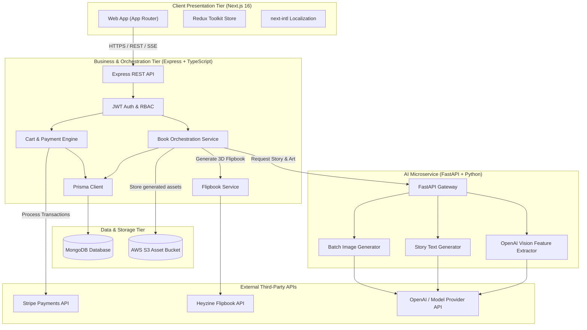
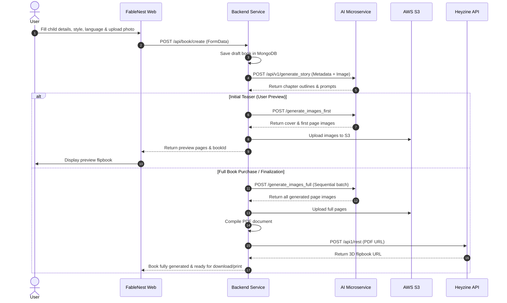
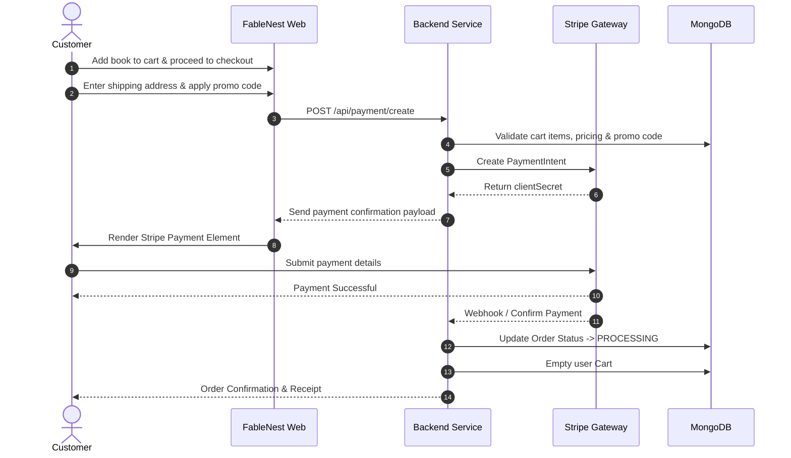
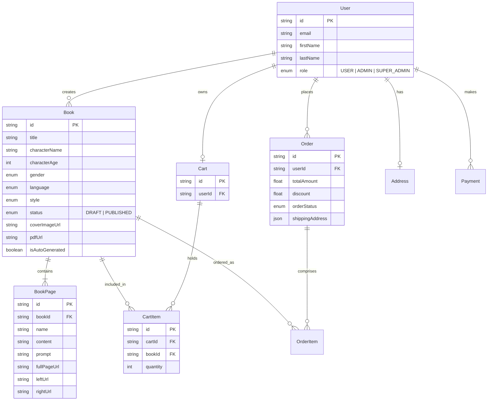

# 🏛️ FableNest — System Architecture Documentation

This document describes the architectural design, component interactions, data models, and workflows powering the **FableNest** personalized storybook platform.

---

## 1. System Topology & High-Level Architecture

FableNest follows a decoupled microservice architecture structured into three core tiers:

1. **Frontend Presentation Tier (`FableNest_Web`)**: Interactive client application built on Next.js 16 with SSR/SSG and client-side rendering.
2. **Core Business Tier (`FableNest_backend`)**: Node.js & Express RESTful service managing users, book lifecycles, payments, and orchestration.
3. **AI Generation Tier (`FableNest_AI`)**: Python FastAPI service running vision analysis, LLM narrative generation, and character-consistent image rendering.

---

## 2. Component Breakdown

### 2.1 Frontend Client (`FableNest_Web`)
- **Framework**: Next.js 16 (App Router), React 19.
- **Styling & UI**: Tailwind CSS v4, Radix UI primitives, Lucide Icons, Framer Motion.
- **State Management**: Redux Toolkit & Redux Persist for wizard form progression and shopping cart state.
- **Internationalization**: `next-intl` supporting English (`en`), French (`fr`), Italian (`it`), and Spanish (`sp`).
- **Core User Journeys**:
  - `create-own-book/`: 7-step wizard (`child-details` ➔ `character` ➔ `photo-upload` ➔ `image-style` ➔ `language` ➔ `story-idea` ➔ `preview` / `full-book`).
  - `checkout/`: Address input, cart overview, Stripe payment element integration.
  - `dashboard/`: Admin console for reviewing drafts, users, and promo codes.

---

### 2.2 Core Backend Server (`FableNest_backend`)
- **Runtime**: Node.js, Express.js, TypeScript.
- **Persistence**: MongoDB accessed via **Prisma ORM**.
- **Key Modules**:
  - `book`: Orchestrates book creation, page regeneration, auto-generated drafts, and PDF generation.
  - `flipbook`: Integrates with the Heyzine API to transform compiled PDFs into responsive 3D flipbook URLs.
  - `payment`: Validates cart calculations, applies promo codes, and completes Stripe PaymentIntents.
  - `order`: Manages order lifecycles (`PENDING` ➔ `PROCESSING` ➔ `SHIPPED` ➔ `DELIVERED`).
  - `auth` & `user`: Manages JWT access/refresh tokens, password resets with OTP, and profile images.

---

### 2.3 AI Microservice (`FableNest_AI`)
- **Runtime**: Python 3.10+, FastAPI, Uvicorn, Pillow (PIL).
- **Core Endpoints**:
  - `POST /api/v1/generate_story`: Accepts character metadata (name, age, gender, language, style, story concept) and returns structured chapter outlines and illustration prompts.
  - `POST /api/v1/generate_images_first`: Generates the cover page and introductory chapter illustrations (teaser generation).
  - `POST /api/v1/generate_images_full`: Sequential batch generation for all book pages with character consistency.
  - `POST /api/v1/image-to-image`: Image conversion, resizing, and style transfer endpoints.
- **Character Consistency Pipeline**:
  1. Uploaded child portrait is analyzed by Vision models.
  2. Extracted features (skin color, hair tone, eye color, eyebrow shape) are injected into base character prompts.
  3. Subsequent generation calls pass continuous character prompts to guarantee visual coherence across pages.

---

## 3. End-to-End Sequence Workflows

### 3.1 Personalized Book Creation & Preview Flow

---

### 3.2 Order & Stripe Checkout Flow

---

## 4. Database Schema (Prisma Data Model)

---

## 5. Security & Architectural Patterns

- **Environment Isolation**: Configuration is decoupled via `.env` files and validated at boot time.
- **Fail-Safe Fallbacks**: If Vision model analysis fails on an uploaded portrait, default character description fallbacks engage smoothly without interrupting the generation pipeline.
- **Stateless Authentication**: JWT tokens with short-lived access lifespans and refresh rotation patterns.
- **Separation of Concerns**: Compute-heavy AI and image operations are isolated in a Python microservice to prevent blocking Node.js event-loop operations.
