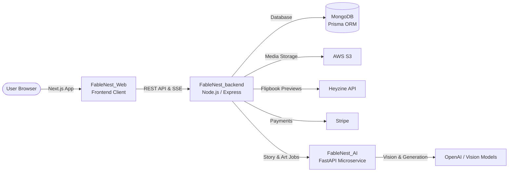

# 📖 FableNest — AI-Powered Personalized Children's Storybook Platform

<div align="center">


**Turn any child into the hero of their own personalized, beautifully illustrated storybook using the power of AI.**

[Features](#-key-features) • [Architecture](#-architecture-overview) • [Getting Started](#-getting-started) • [Directory Structure](#-directory-structure) • [Environment Setup](#-environment-variables)

</div>

---

## 🌟 Overview

**FableNest** is an end-to-end platform that enables parents, family members, and educators to create custom, personalized storybooks for children. 

By simply uploading a photo of a child and selecting their preferences (name, age, gender, story ideas, and artistic styles), FableNest's AI microservice analyzes physical features (skin tone, hair color, facial features) to create character-consistent illustrations and narrative chapters across 5 languages. 

Users can preview their customized book in a 3D digital flipbook, regenerate specific pages, and order downloadable high-resolution PDFs or printed physical books delivered to their door.

---

## ✨ Key Features

- **Personalized Character Likeness**: Vision-based AI extracts distinct features from uploaded photos (skin color, hair style/color, eyebrows) to ensure character consistency across every page.
- **Multiple Artistic Styles**:
  - 🎨 *Pixar 3D*
  - 🌸 *Anime*
  - 📖 *Children's Manga*
  - 🖌️ *Semi-Realistic Cartoon*
- **Multilingual Storytelling**: Generate stories adapted culturally and grammatically in 5 languages:
  - English, Spanish, French, Italian, and Arabic.
- **Interactive 3D Flipbook**: Instant realistic page-turning previews powered by Heyzine API before purchasing.
- **Page Regeneration**: Re-roll any individual page's illustration or text if the user wants another creative option.
- **Complete E-Commerce Suite**:
  - Shopping cart and coupon/promo code engine.
  - Secure payments powered by **Stripe**.
  - Multi-status order fulfillment lifecycle (`PENDING`, `PROCESSING`, `SHIPPED`, `DELIVERED`).
- **Comprehensive Admin Dashboard**: Monitor book drafts, manage users, configure pricing, and review auto-generated books.

---

## 🏗️ Architecture Overview

The platform is designed as a modular monorepo comprising three specialized services:



> 📘 For an in-depth breakdown of schemas, communication flows, and system patterns, see [ARCHITECTURE.md](./ARCHITECTURE.md).

---

## 📁 Directory Structure

```
ba/
├── FableNest_Web/              # Next.js 16 frontend application
│   ├── app/                    # App Router (localized routes, auth, dashboard, creation wizard)
│   ├── components/             # Reusable UI components & Radix primitives
│   ├── hooks/                  # Custom React hooks
│   ├── message/                # i18n localization translation strings (en, fr, it, sp)
│   ├── store/                  # Redux Toolkit state slices
│   └── package.json
│
├── FableNest_backend/          # Node.js + Express backend service
│   ├── prisma/                 # Prisma schema & MongoDB models
│   ├── src/
│   │   ├── app/
│   │   │   ├── modules/        # Domain modules (book, cart, order, payment, user, etc.)
│   │   │   ├── middlewares/    # Auth, validation, file upload handlers
│   │   │   └── utils/          # Email helpers, S3 uploaders, OTP generation
│   │   ├── config/             # Environment configs & service accounts
│   │   └── server.ts           # Server bootstrap
│   └── package.json
│
└── FableNest_AI/               # FastAPI AI story & illustration microservice
    ├── app/
    │   └── services/
    │       ├── Text_with_image/  # Story generation, vision feature analysis, batch images
    │       ├── Image_to_Image/   # Image transformation & styling
    │       └── Faceswap/         # Face swap routines
    ├── main.py                 # FastAPI application root
    ├── Dockerfile
    ├── docker-compose.yml
    └── requirements.txt
```

---

## 🚀 Getting Started

### Prerequisites

Ensure you have the following installed on your machine:
- **Node.js** (v18.x or v20.x recommended) & **npm** / **pnpm**
- **Python** (v3.10 or higher) & `pip`
- **MongoDB** (Local instance or MongoDB Atlas URI)

---

### 1. Setup AI Microservice (`FableNest_AI`)

```bash
cd FableNest_AI

# Create and activate virtual environment
python -m venv venv
# On Windows:
.\venv\Scripts\activate
# On Linux/macOS:
source venv/bin/activate

# Install dependencies
pip install -r requirements.txt

# Configure environment
cp .env.example .env  # Add your OPENAI_API_KEY / ARK_API_KEY

# Run server
python main.py
# Runs at http://localhost:8000 (Swagger docs at http://localhost:8000/docs)
```

---

### 2. Setup Backend Server (`FableNest_backend`)

```bash
cd FableNest_backend

# Install dependencies
npm install

# Configure environment variables
# Copy .env.example or configure .env (see Environment Variables section)

# Generate Prisma Client
npm run prisma:gen

# Run in development mode
npm run dev
# Server runs at http://localhost:5058
```

---

### 3. Setup Frontend Web (`FableNest_Web`)

```bash
cd FableNest_Web

# Install dependencies
pnpm install # or npm install

# Run development server
pnpm dev
# Accessible at http://localhost:3010
```

---

## ⚙️ Environment Variables

### Backend (`FableNest_backend/.env`)

| Variable | Description |
| :--- | :--- |
| `PORT` | Backend port (default `5058`) |
| `DATABASE_URL` | MongoDB connection URI |
| `JWT_SECRET` | Secret key for JWT access tokens |
| `JWT_REFRESH_SECRET` | Secret key for JWT refresh tokens |
| `AI_BASE_URL` | URL of the running `FableNest_AI` service (`http://localhost:8000/api/v1`) |
| `STRIPE_SECRET_KEY` | Stripe secret key for processing charges |
| `HEYZINE_API_KEY` | Heyzine API key for flipbook generation |
| `AWS_ACCESS_KEY_ID` | AWS S3 access key for media storage |
| `AWS_SECRET_ACCESS_KEY` | AWS S3 secret key |
| `AWS_S3_BUCKET` | AWS S3 bucket name |

---

## 🔒 Security & Privacy

- **Protected Secrets**: `.env` and sensitive production credentials are kept strictly out of source control.
- **Role-Based Access Control**: Granular roles (`USER`, `ADMIN`, `SUPER_ADMIN`) guarding API endpoints and admin dashboard functions.
- **Child Privacy**: Uploaded reference photos are processed solely for feature extraction and prompt generation, with media assets securely stored.

---

## 📄 License

This project is licensed under the [MIT License](LICENSE).
